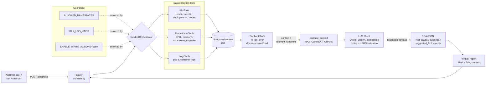

<p align="center">
  <a href="./README.md"><b>🇬🇧 English</b></a> &nbsp;|&nbsp; <a href="./README.ru.md"><b>🇷🇺 Читать на русском </b></a>
</p>

<h1 align="center">K8s Incident Diagnosis AI Agent</h1>

<p align="center">
  
</p>

# K8s Incident Diagnosis AI Agent

[](https://github.com/Mkft1/ai_agent_DevOps/actions/workflows/ci.yml)


[](./LICENSE)
[](./Dockerfile)
[](https://github.com/astral-sh/ruff)

An LLM-powered SRE agent that diagnoses Kubernetes incidents end-to-end. It ingests alerts via a REST API, correlates live signals — pod status, Kubernetes events, Prometheus metrics, container logs — grounds the analysis with TF-IDF retrieval over local runbooks (RAG), and returns a structured **Root Cause Analysis (RCA)** plus a human-readable report ready for Slack/Telegram.

The agent is strictly **read-only by default**: it never mutates the cluster (`ENABLE_WRITE_ACTIONS=false`), so it is safe to expose to production alert pipelines.

---

## Features

| | |
|---|---|
| 🧠 **LLM RCA** | OpenAI-compatible chat API (Qwen/DashScope by default) with strict JSON output validated by Pydantic; automatic one-shot retry on invalid JSON and an honest fallback diagnosis. |
| 📚 **RAG over runbooks** | Local Markdown runbooks (`docs/runbooks/*.md`) indexed with scikit-learn TF-IDF; the most relevant playbooks are injected into the LLM context as `relevant_runbooks` and drive `suggested_fix`. |
| ☸️ **Kubernetes integration** | Official Python client: pods, events, deployments, nodes, container logs (including pre-restart logs for OOMKilled/CrashLoopBackOff). |
| 📈 **Prometheus integration** | instant & range queries, per-pod CPU/memory usage via `container_*` cAdvisor metrics. |
| 🛡️ **Guardrails** | Namespace allow-list (`ALLOWED_NAMESPACES`), log-size cap (`MAX_LOG_LINES`), context-size cap (`MAX_CONTEXT_CHARS`), read-only mode (`ENABLE_WRITE_ACTIONS`). All configurable via `.env`, nothing hardcoded. |
| 🩹 **Graceful degradation** | If any data source fails (K8s API down, Prometheus unreachable, empty logs), the agent records a warning in the report and continues diagnosing with whatever data it has — it never crashes the pipeline. |
| 📊 **Observability** | `/metrics` endpoint (`prometheus-fastapi-instrumentator`) + custom counters/histograms: `diagnose_requests_total`, `diagnose_duration_seconds`, `k8s_api_errors_total`, `llm_fallback_total`. |
| 🔁 **Chaos self-test** | `scripts/chaos_test.py` creates an ImagePullBackOff pod, asks the agent to diagnose it, asserts the RCA mentions "image"/"pull", and cleans up. Idempotent. |
| 🧪 **Testing & CI/CD** | 111 unit/integration tests with mocked clients; GitHub Actions pipeline: lint → test+coverage → Docker build → kind-based e2e on `main`. |
| 🐳 **Containerized** | Multi-stage `python:3.12-slim` image, non-root user, healthcheck, no secrets baked into the image. |

---

## Architecture



Pipeline in one line:

`Alertmanager → POST /diagnose → IncidentOrchestrator → [K8sTools, PrometheusTools, LogsTools] → RunbookRAG → LLM → RCA → Report`

---
## Architecture Decisions

A few deliberate trade-offs worth knowing about:

1. **TF-IDF RAG instead of a vector database.** Runbooks are small (a handful of Markdown files), so scikit-learn's `TfidfVectorizer` gives good-enough retrieval with **zero external infrastructure** — no embeddings API, no Chroma/Qdrant sidecar, no extra network hop. The index is rebuilt in-process at startup; adding knowledge is just dropping a `.md` file into `docs/runbooks/`. Swapping to embeddings later only touches `src/agent/rag.py`.
2. **FastAPI + pydantic-settings.** FastAPI gives async request handling, automatic OpenAPI docs (`/docs` Swagger UI) and request/response validation out of the box; pydantic models make the incident contract (`Incident`, `Diagnosis`) explicit and testable, and all configuration is env-driven via one `Settings` class.
3. **Strict JSON output validated by Pydantic, with one retry and an honest fallback.** Instead of trusting free-form LLM prose, the system prompt demands a fixed JSON schema; invalid responses trigger a single correction retry, then a deterministic fallback diagnosis (`severity="unknown"`) — the pipeline never returns garbage or crashes because of the model.
4. **Read-only by default + graceful degradation.** The agent suggests fixes rather than executing them (`ENABLE_WRITE_ACTIONS=false`), and any failing data source becomes a warning in the report instead of an exception — safe to wire directly into production alert pipelines.
5. **OpenAI-compatible client over raw HTTP (requests + tenacity).** No heavyweight SDK lock-in: works with Qwen/DashScope, OpenAI, or any self-hosted compatible gateway by changing two env vars (`LLM_BASE_URL`, `LLM_MODEL`).
---

## Quick Start

### 1. Configure environment

```bash
cp .env.example .env
# edit .env: set QWEN_API_KEY (or OPENAI_API_KEY), KUBECONFIG_PATH, PROMETHEUS_URL
```

| Variable | Default | Description |
|---|---|---|
| `KUBECONFIG_PATH` | `~/.kube/config` | Path to the kubeconfig used by K8sTools/LogsTools. |
| `PROMETHEUS_URL` | `http://localhost:9090` | Base URL of your Prometheus instance. |
| `LOG_LEVEL` | `INFO` | Application log level (`DEBUG` also logs prompts/LLM responses, without secrets). |
| `QWEN_API_KEY` / `OPENAI_API_KEY` | — | LLM API key (`QWEN_API_KEY` takes precedence). Never hardcoded, only via env. |
| `LLM_BASE_URL` | DashScope compatible-mode | OpenAI-compatible endpoint (`.../v1` suffix optional). |
| `LLM_MODEL` | `qwen-max` | Chat model name — swap freely (gpt-4o-mini, qwen-plus, ...) without code changes. |
| `CORS_ORIGINS` | `["*"]` | Allowed CORS origins (JSON list, e.g. `["http://localhost:3000"]`). |
| `ALLOWED_NAMESPACES` | `["default"]` | Namespaces the agent may inspect; anything else → HTTP 403. |
| `MAX_LOG_LINES` | `200` | Hard cap on `tail_lines` for log retrieval. |
| `MAX_CONTEXT_CHARS` | `16000` | Max serialized size of the LLM context (long strings get truncated with `... [truncated]`). |
| `ENABLE_WRITE_ACTIONS` | `false` | Read-only mode. No write path exists in the codebase today. |

### 2. Run locally

```bash
python -m venv .venv && source .venv/bin/activate
pip install -r requirements.txt
uvicorn src.main:app --reload --host 0.0.0.0 --port 8000
```

Interactive API docs (Swagger UI): **http://localhost:8000/docs**

#### Developer shortcuts with `make`

A `Makefile` in the repo root wraps the most common commands so you don't have to remember them:

```bash
make install       # pip install -r requirements.txt -r requirements-dev.txt
make lint          # ruff check src tests scripts
make test          # pytest --cov=src --cov-report=term-missing tests/
make run           # uvicorn src.main:app --host 0.0.0.0 --port 8000 --reload
make docker-build  # docker build -t ai-agent-devops:local .
make chaos         # python scripts/chaos_test.py (ImagePullBackOff self-test)
make e2e           # bash scripts/run_integration_test.sh (kind cluster, end-to-end)
```

The Makefile is a convenience wrapper only — it does not change or replace CI/CD.

#### Real `/diagnose` response (OOMKilled incident)

The agent retrieves the matching runbook (`docs/runbooks/oom_killed.md`) via RAG and grounds the fix on it:

```json
{
  "diagnosis": {
    "root_cause": "Container 'payments-api' is being OOMKilled: working set (~488 MiB) has reached the 512Mi memory limit; the batch allocation at 09:40:55 triggers a cgroup OOM kill (3 restarts, matching Warning events).",
    "evidence": [
      "container_memory_working_set_bytes = 511705088 bytes (~488 MiB) vs limit 512Mi",
      "Pod status shows 5 restarts; last state reason: OOMKilled",
      "K8s Warning event 'OOMKilling' for pod/payments-api-7d9f4b-x2kq",
      "Logs: 'fatal error: runtime: out of memory' right before container exit",
      "Runbook oom_killed.md: raise memory limit or cap batch size"
    ],
    "suggested_fix": "Increase the container memory limit to 1Gi (kubectl patch) and cap the batch buffer size via PAYMENTS_BATCH_MB=128; then roll the deployment and watch restarts drop to zero.",
    "severity": "high",
    "warnings": []
  },
  "report": "🟠 Incident: diagnosis (severity: high)\nNamespace: default, Pod: payments-api-7d9f4b-x2kq\n..."
}
```

### 3. Run with Docker

```bash
docker build -t k8s-incident-agent .
docker run --rm -p 8000:8000 \
  --env-file .env \
  -v "$HOME/.kube/config:/home/appuser/.kube/config:ro" \
  k8s-incident-agent
```

### 4. Run with docker-compose

```bash
docker compose up --build
# app on http://localhost:8000, kubeconfig and .env mounted read-only
```

---

## API

| Method | Path | Description |
|---|---|---|
| `GET` | `/health` | Liveness probe → `{"status": "ok"}`. |
| `GET` | `/ready` | Checks K8s API + Prometheus reachability → `200` or `503`. |
| `POST` | `/diagnose` | Accepts an incident, returns `{diagnosis, report}`. |
| `GET` | `/metrics` | Prometheus exposition format (HTTP + custom metrics). |

### Example: `POST /diagnose`

Request:

```bash
curl -s -X POST http://localhost:8000/diagnose \
  -H 'Content-Type: application/json' \
  -d '{
    "namespace": "default",
    "pod_name": "payments-api-7d9f4b-x2kq",
    "description": "Pod payments-api restarts repeatedly, alert: ContainerOOMKilling"
  }'
```

Response (excerpt — produced by the real orchestrator pipeline; deterministic LLM stand-in used here to avoid spending API tokens):

```json
{
  "diagnosis": {
    "root_cause": "Container 'payments-api' is being OOMKilled: working set (~488 MiB) has reached the 512Mi memory limit; the batch allocation at 09:40:55 triggers a cgroup OOM kill (3 restarts, matching Warning events).",
    "evidence": [
      "container_memory_working_set_bytes = 511705088 bytes (~488 MiB) vs limit 512Mi",
      "Pod status shows 5 restarts; last state reason: OOMKilled",
      "K8s Warning event 'OOMKilling' for pod/payments-api-7d9f4b-x2kq",
      "Logs: 'fatal error: runtime: out of memory' right before container exit",
      "Runbook oom_killed.md: raise memory limit or cap batch size"
    ],
    "suggested_fix": "Increase the container memory limit to 1Gi (kubectl patch) and cap the batch buffer size via PAYMENTS_BATCH_MB=128; then roll the deployment and watch restarts drop to zero.",
    "severity": "high",
    "warnings": []
  },
  "report": "🟠 *Incident: diagnosis* (severity: high)\n*Namespace:* `default`, *Pod:* `payments-api-7d9f4b-x2kq`\n..."
}
```

Note how the last piece of evidence comes from the **RAG-retrieved runbook** (`oom_killed.md`) — retrieved automatically from the pod status + log lines, not hardcoded.

### Example: chaos scenario (ImagePullBackOff)

After running `python scripts/chaos_test.py` against a live cluster + local agent:

```bash
curl -s -X POST http://localhost:8000/diagnose \
  -H 'Content-Type: application/json' \
  -d '{"namespace": "default", "pod_name": "bad-pod", "description": "Pod in ImagePullBackOff"}'
```

```json
{
  "diagnosis": {
    "root_cause": "Image pull failure for pod 'bad-pod': the tag 'definitely-bad-tag-404' does not exist in the registry (ErrImagePull -> backoff).",
    "severity": "medium",
    "suggested_fix": "Fix the image tag in the Deployment spec to an existing tag (e.g. nginx:1.27) and roll the deployment."
  }
}
```

---

## Security & Guardrails

All limits are configuration-driven (see table above), enforced **before** any cluster call:

1. **Namespace allow-list** — requests for namespaces outside `ALLOWED_NAMESPACES` fail fast with `"Namespace not allowed"` (HTTP 403); no API calls are made.
2. **Read-only by design** — with `ENABLE_WRITE_ACTIONS=false` the agent only reads data and *suggests* fixes. There is no delete/exec/apply code path in the repository; the flag guards future action-proposing features.
3. **Bounded context** — log tails capped by `MAX_LOG_LINES`; the whole LLM context is recursively trimmed to `MAX_CONTEXT_CHARS` (long values keep their tail — the freshest log lines — and are marked `... [truncated]`).
4. **No secrets anywhere** — API keys come exclusively from `.env` (never committed, excluded from the Docker image via `.dockerignore`); prompt/response logging at DEBUG never includes auth headers.
5. **Graceful degradation** — a failing tool produces a warning in the report ("K8s API unavailable, using only Prometheus metrics"), not a crash.
6. **Non-root container** — the runtime image runs as `appuser` (UID 10001) with a read-only kubeconfig mount.

---

## Testing

```
tests/
├── test_k8s_tools.py         # K8s client mocking (pods/events/deployments/nodes, ApiException paths)
├── test_prometheus_tools.py  # HTTP mocking: success, timeouts, 5xx, parsing
├── test_logs_tools.py        # read_namespaced_pod_log mocking
├── test_orchestrator.py      # full pipeline w/ mocks, graceful degradation, guardrails
├── test_llm_integration.py   # LLMClient: retries (429/5xx), JSON validation, fallback
├── test_rag.py               # RunbookRAG on fixture md-files + orchestrator integration
├── test_text_utils.py        # truncate_context recursion & guarantees
├── test_chaos_test.py        # chaos script logic (mocked k8s + requests)
└── test_api.py               # FastAPI TestClient: /health /ready /diagnose /metrics, CORS, errors
```

- **Unit tests**: every external boundary (Kubernetes API, Prometheus HTTP, LLM HTTP) is mocked — the suite runs offline in ~2 seconds.
- **Coverage**: `pytest --cov=src --cov-report=xml` — currently **~89%** (uploaded as a CI artifact every run).
- **Integration (end-to-end)**: `scripts/run_integration_test.sh` spins up a real [kind](https://kind.sigs.k8s.io/) cluster, creates a pod with a bad image tag, runs the agent under uvicorn, sends a real `POST /diagnose`, and asserts the RCA mentions *"image"*/*"pull"* (via `jq`). Idempotent: leftover clusters/pods are removed before each run; cleanup happens even on failure.
- **CI jobs** (GitHub Actions): `lint` (ruff) → `test` (pytest + coverage) → `build` (Docker, load + smoke-test) → `integration-test` (kind, push to `main` only, so PRs stay fast).

---

## Contributing

### Dev environment

```bash
python -m venv .venv && source .venv/bin/activate
pip install -r requirements-dev.txt   # runtime deps + ruff, pytest, pytest-cov, httpx
```

### Before opening a PR

```bash
ruff check src tests scripts          # linter (config in pyproject.toml)
pytest --cov=src tests/               # all tests must pass
```

### Project rules

- Follow Git flow in this repo: sync with `main` first (`git fetch origin main && git rebase origin/main`), one feature branch per task, clean diffs.
- Keep the agent **read-only** unless a task explicitly adds guarded write actions.
- New settings go through `src/config.py` (pydantic-settings) + `.env.example` — never hardcode.
- Every new tool method must swallow `ApiException`/HTTP errors and return an empty result + logged warning (graceful degradation principle).

### Adding a new runbook (RAG)

1. Create `docs/runbooks/<your_incident>.md` — use the existing files as templates: `Symptoms`, `Root causes`, `How to fix` (with copy-pasteable `kubectl` commands), `Prevention`.
2. Write naturally — the TF-IDF index is rebuilt at startup, no registration step needed.
3. Sanity-check retrieval:
   ```bash
   python -c "from src.agent.rag import RunbookRAG; print([t.splitlines()[0] for t in RunbookRAG().find_relevant('your sample error text')])"
   ```
4. Optionally add a keyword assertion to `tests/test_rag.py`.

---

## Project structure

```
ai_agent_DevOps/
├── .github/workflows/ci.yml     # lint → test → build → integration-test (kind)
├── Dockerfile                   # multi-stage, non-root, healthcheck
├── docker-compose.yml           # local stack: agent + kubeconfig/.env mounts
├── Makefile                     # dev shortcuts: install/lint/test/run/docker-build/chaos/e2e
├── docs/runbooks/               # RAG knowledge base (oom_killed, image_pull_backoff, crash_loop)
├── scripts/
│   ├── chaos_test.py            # ImagePullBackOff chaos experiment vs /diagnose
│   ├── run_integration_test.sh  # kind-based end-to-end test
│   └── kind/cluster.yaml        # kind cluster config
├── src/
│   ├── main.py                  # FastAPI app: /health /ready /diagnose /metrics, CORS, error handlers
│   ├── config.py                # pydantic-settings (.env driven)
│   ├── prompts/sre_system.txt   # system prompt for the LLM (loaded at init, fallback in code)
│   ├── agent/
│   │   ├── orchestrator.py      # IncidentOrchestrator: pipeline, guardrails, degradation, reporting
│   │   ├── llm_client.py        # OpenAI-compatible client: tenacity retries, 30s timeout
│   │   ├── rag.py               # RunbookRAG: TF-IDF retrieval over docs/runbooks
│   │   └── tools/               # k8s_tools.py, prometheus_tools.py, logs_tools.py
│   └── utils/
│       ├── logger.py            # stdlib logging setup
│       ├── metrics.py           # custom Prometheus metrics
│       └── text_utils.py        # truncate_context (bounded, JSON-safe)
└── tests/                       # 111 tests, fully mocked externals
```

---

## License

[MIT](./LICENSE)
