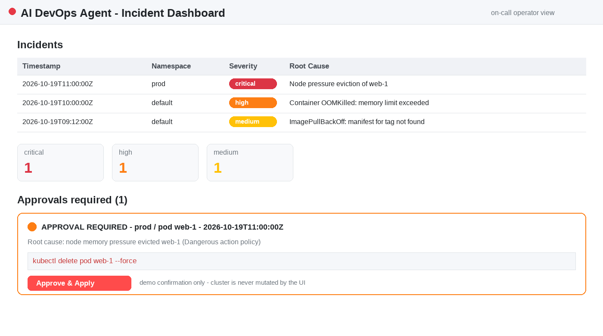
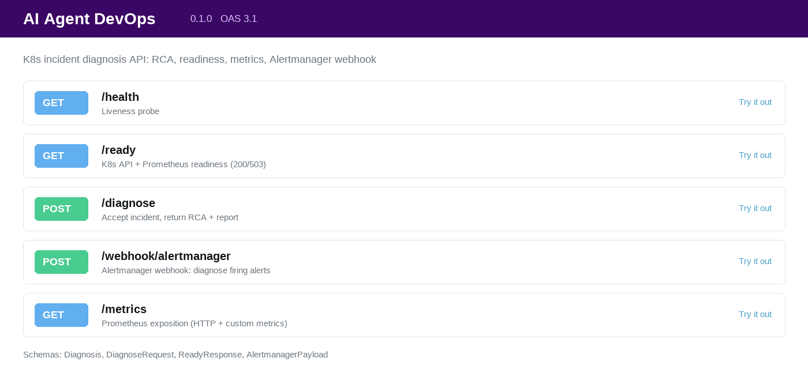

<p align="center">
  <a href="./README.md"><b>🇬🇧 English </b></a> &nbsp;|&nbsp; <a href="./README.ru.md"><b>🇷 Русский</b></a>
</p>

| Интерактивный дашборд | Документация API (Swagger) |
|---|---|
|  |  |

<h1 align="center">ИИ-агент для диагностики инцидентов в K8s</h1>


AI-агент для диагностики инцидентов в Kubernetes. Русская и английская ([README.md](./README.md)) версии синхронизированы и описывают актуальное состояние проекта; англоязычная версия дополнительно содержит Mermaid-диаграмму архитектуры и раздел архитектурных решений.

[](https://github.com/Mkft1/ai_agent_DevOps/actions/workflows/ci.yml)
[](https://www.python.org/downloads/)
[](./Dockerfile)
[](./LICENSE)
[](#тесты)
[](https://github.com/astral-sh/ruff)

AI-агент для диагностики инцидентов в Kubernetes.

## Архитектура

```
+------------------+     POST /diagnose      +------------------------+
|  Alertmanager /  | ----------------------> |   FastAPI (src/main.py)|
|  curl / чат-бот  |                         +-----------+------------+
+------------------+                                     |
                                                         v
                     +---------------------------------------------------------------+
                     |                    IncidentOrchestrator (diagnose)            |
                     |   guardrails: ALLOWED_NAMESPACES / MAX_LOG_LINES / read-only  |
                     +---------+-----------------+-------------------------+---------+
                               |                 |                         |
                       +-------v------+   +------v--------+       +--------v-----+
                       |  K8sTools    |   |PrometheusTools|       |  LogsTools   |
                       | pods/events/ |   | query, pod    |       | pod/container|
                       | nodes        |   | cpu/memory    |       | logs         |
                       +-------+------+   +------+--------+       +--------+-----+
                               |                 |                         |
                               +-----------------+-------------------------+
                                                 |
                                       структурированный контекст (dict)
                                                 v
                       структурированный контекст (+ relevant_runbooks из RAG)
                                                 v
                                    +--------------------------+
                                    | RunbookRAG (TF-IDF по    |
                                    | docs/runbooks/*.md)      |
                                    +------------+-------------+
                                                 v
                                    +--------------------------+
                                    | LLMClient (Qwen/OpenAI-  |
                                    | совместимый API, retries)|
                                    +------------+-------------+
                                                 |
                                        RCA (JSON: root_cause,
                                        evidence, suggested_fix, severity)
                                                 v
                                    format_report() -> отчёт
                                    для Slack / Telegram
```

Поток простыми словами:

```
Alertmanager → /diagnose → IncidentOrchestrator → [K8sTools, PrometheusTools, LogsTools] → RunbookRAG(docs) → LLM → RCA → Report
```

## Что демонстрирует проект

- **Работа с Kubernetes API** — официальный python-клиент: поды, события, деплойменты,
  узлы, чтение логов контейнеров (`read_namespaced_pod_log`), включая логи до рестарта.
- **Интеграция с Prometheus** — instant/range запросы через HTTP API, PromQL-выражения
  для CPU и памяти пода (`rate(container_cpu_usage_seconds_total)`, working set).
- **LLM-интеграция** — OpenAI-совместимый API (Qwen/DashScope): системный промт SRE-эксперта,
  строгая pydantic-валидация JSON-ответа, retry с указанием ошибки валидации и fallback-диагноз;
  клиент за DI-протоколом — заглушка легко меняется на реальный API и наоборот.
- **Обработка ошибок и отказоустойчивость** — ни один сбой инструмента (ApiException,
  HTTP 5xx, network timeout) не роняет сервис: шаги помечаются в `warnings`, диагностика
  продолжается с частичными данными; ретраи tenacity с экспоненциальной задержкой.
  Отсутствие kubeconfig при старте деградирует K8s/логи до пустых результатов, а отсутствие
  LLM-ключа даёт честный `503` с подсказкой (или stub-режим при `LLM_OFFLINE=true`) — не `500`.
- **Наблюдаемость** — `X-Request-ID` в каждом ответе (эхо входящего или сгенерированный),
  структурированное JSON-логирование (`LOG_FORMAT=json`) с корреляцией по `request_id`,
  append-only журнал аудита (`AUDIT_LOG_PATH`, JSON Lines) и **распределённый трейсинг
  OpenTelemetry**: авто-спаны на каждый HTTP-запрос плюс ручные спаны на каждый вызов
  K8s/Prometheus/логов/RAG/LLM с экспортом по OTLP в Jaeger/Tempo.
- **Интеграция с Alertmanager** — `POST /webhook/alertmanager` принимает стандартный
  пейлоад (version/status/alerts), диагностирует каждый `firing`-алерт (namespace и pod
  из `labels`, текст из `annotations.summary`/`description`), пропускает `resolved`
  и возвращает `400` на битом JSON/схеме.
- **Безопасность (guardrails)** — read-only по умолчанию, белый список namespace'ов,
  лимит строк логов, секреты только через `.env`, non-root контейнер, `.dockerignore`,
  политика опасных действий: рекомендации с `delete`/`drop`/`rm -rf`/`scale 0`
  помечаются `requires_approval: true` и уходят на аппрув человеку в Slack.
- **Helm-чарт** — production-ready `charts/ai-agent` (v0.1.0): Deployment с probes
  и non-root securityContext, ClusterIP Service, least-privilege RBAC,
  ConfigMap/Secret из `values.yaml`, `make helm-lint` / `make helm-install`.
- **Дашборд оператора** — `make dashboard`: Streamlit-UI поверх журнала аудита
  (таблица инцидентов Timestamp/Namespace/Severity/Root Cause, метрики по severity,
  карточки аппрува с `suggested_fix` и кнопкой "Approve & Apply" для инцидентов с
  `requires_approval=true`); запускается отдельно от FastAPI, кластер не трогает.
- **Тестирование** — 233 unit/интеграционных тестов (pytest + unittest.mock), покрытие ~92%
  (гейт в CI `--cov-fail-under=85`): инструменты, оркестратор, LLM-клиент (мок HTTP),
  FastAPI-эндпоинты (TestClient), конфигурация и логирование, chaos-скрипт.
- **DevOps-практики** — многоступенчатый Docker-образ, docker-compose, идемпотентный
  chaos-эксперимент (ImagePullBackOff) как end-to-end проверка качества диагностики.
- **Evaluation-фреймворк** — `make eval`: золотой датасет инцидентов прогоняется через
  реальный пайплайн (RAG + LLM) без кластера, а второй LLM-вызов выступает судьёй
  (LLM-as-a-judge, шкала 1–5 по смыслу); метрики — средний балл и runbook hit-rate,
  exit code работает как regression-гейт для промптов/ранбуков/моделей.

## Что делает агент

- Читает **метрики** из Prometheus (загрузка CPU/RAM, ошибки, задержки).
- Собирает и анализирует **логи** контейнеров и компонентов кластера.
- Проверяет **состояние подов**, деплоев и других ресурсов Kubernetes.
- Подтягивает релевантные **runbook'и** гибридным RAG-поиском по `docs/runbooks/`:
  `0.5 × TF-IDF` (точные термины) + `0.5 × косинусная близость эмбеддингов`
  (sentence-transformers `all-MiniLM-L6-v2`, поиск по смыслу); найденные
  инструкции попадают в контекст LLM как `relevant_runbooks`. Без векторной
  БД и внешних сервисов; если модель недоступна — graceful fallback на TF-IDF.
- Формирует гипотезу о причине инцидента и предлагает **RCA** (Root Cause Analysis)
  с рекомендациями для on-call инженера.

## Структура проекта

```
ai_agent_DevOps/
├── README.md
├── requirements.txt
├── requirements-dev.txt   # dev-зависимости: pytest, pytest-cov, httpx, ruff
├── pyproject.toml         # конфиг ruff (линт в CI)
├── .gitignore
├── .env.example
├── .github/
│   └── workflows/
│       └── ci.yml         # CI: lint (ruff) -> test (pytest+cov) -> build (Docker, no push)
├── src/
│   ├── main.py            # Точка входа FastAPI: /health /ready /diagnose /metrics /webhook/alertmanager
│   ├── api/
│   │   └── models.py      # pydantic-контракты: пейлоад Alertmanager -> Incident
│   ├── config.py          # Загрузка конфигурации из .env
│   ├── agent/
│   │   ├── orchestrator.py  # Оркестрация шагов диагностики (K8s -> контекст -> LLM -> RCA)
│   │   ├── policies.py      # политика опасных фиксов (delete/drop/rm -rf/scale 0) -> аппрув
│   │   ├── llm_client.py    # Реальный LLM-клиент (Qwen / OpenAI-совместимый API, ретраи tenacity)
│   │   ├── rag.py           # RunbookRAG: гибридный поиск (TF-IDF + эмбеддинги) по runbook'ам
│   │   └── tools/
│   │       ├── k8s_tools.py         # Инструменты Kubernetes
│   │       ├── prometheus_tools.py  # Инструменты Prometheus
│   │       └── logs_tools.py        # Инструменты логов
│   ├── prompts/
│   │   └── sre_system.txt # Системный промт SRE-эксперта (редактируется без кода)
│   └── utils/
│       ├── audit.py       # Журнал аудита диагностик (append-only JSON Lines)
│       ├── logger.py      # Базовое логирование
│       ├── metrics.py     # Кастомные Prometheus-метрики агента
│       └── text_utils.py  # truncate_context: рекурсивная обрезка контекста для LLM
├── eval/
│   ├── golden_dataset.json  # золотые инциденты: ожидаемый root cause + runbook
│   └── evaluate.py          # harness LLM-as-a-judge (make eval), без кластера
├── manifests/
│   ├── agent-rbac.yaml      # least-privilege SA/Role/RoleBinding (только чтение)
│   └── policies/            # Kyverno ClusterPolicies: lockdown kube-system,
│                            # гейт agent-managed=true для write-действий
├── charts/ai-agent/         # production Helm-чарт (v0.1.0): deployment, service,
│                            # SA/RBAC, configmap, secret, helpers
├── ui/
│   └── dashboard.py         # Streamlit-UI оператора поверх audit.jsonl (make dashboard)
├── docs/
│   ├── assets/              # демо-ассеты (placeholder под будущий demo.gif)
│   └── runbooks/            # RAG-база: 8 runbook'ов (OOMKilled, ImagePullBackOff, CrashLoop, DNS, NodeNotReady, PVCPending, CreateContainerConfigError, Evicted)
├── tests/
├── scripts/
│   ├── chaos_test.py      # chaos-эксперимент: ImagePullBackOff -> /diagnose (идемпотентный)
│   ├── run_integration_test.sh  # e2e-тест на kind-кластере (создание/диагностика/очистка)
│   └── kind/
│       └── cluster.yaml   # конфигурация kind-кластера для интеграционного теста
├── Makefile               # dev-команды: install/lint/test/run/docker-build/chaos/e2e
├── Dockerfile             # multi-stage (base/builder/runtime), CPU-only torch, non-root, healthcheck
├── docker-compose.yml     # локальный запуск сервиса agent (порт 8000)
├── .dockerignore          # .git/.env/tests/.venv/__pycache__ не попадают в образ
├── LICENSE                # MIT
└── CONTRIBUTING.md        # правила запуска тестов и контрибьюшена
```

## Запуск

> 🎬 **Заглушка демо-GIF.** Записанный терминальный демо будет лежать в
> `docs/assets/demo.gif` (как записать — terminalizer/asciinema — см.
> [docs/assets/demo_placeholder.md](docs/assets/demo_placeholder.md)).
> Пока что агент в действии показывают превью выше и реальные ответы
> `/diagnose` ниже.

### Локально (без Docker)

```bash
python -m venv .venv && source .venv/bin/activate
pip install -r requirements.txt
cp .env.example .env   # заполните переменные окружения
uvicorn src.main:app --reload
```

#### Developer shortcuts с `make`

`Makefile` в корне репозитория оборачивает частые команды:

```bash
make install       # pip install -r requirements.txt -r requirements-dev.txt
make lint          # ruff check src tests scripts
make test          # pytest --cov=src --cov-report=term-missing tests/
make run           # uvicorn src.main:app --host 0.0.0.0 --port 8000 --reload
make docker-build  # docker build -t ai-agent-devops:local .
make chaos         # python scripts/chaos_test.py (ImagePullBackOff self-test)
make e2e           # bash scripts/run_integration_test.sh (kind cluster, end-to-end)
make eval          # python eval/evaluate.py (quality-гейт LLM-as-a-judge)
make dashboard     # streamlit run ui/dashboard.py (UI оператора на :8501)
```

### В Docker

Сборка и запуск одним контейнером (секреты подгружаются только в рантайме, `.dockerignore` не пускает `.env` в образ):

```bash
cp .env.example .env                      # заполните QWEN_API_KEY / OPENAI_API_KEY и др.
docker build -t ai-agent-devops .         # многоступенчатая сборка: builder + runtime
docker run -d --name ai-agent \
  -p 8000:8000 \
  --env-file .env \
  -v ~/.kube/config:/home/appuser/.kube/config:ro \
  ai-agent-devops
```

### docker-compose (рекомендуемый локальный вариант)

Поднимает сервис `agent` на порту 8000, подгружает `.env` и монтирует kubeconfig только для чтения:

```bash
docker compose up --build -d
docker compose logs -f agent              # логи сервиса
docker compose down                       # остановка
```

Проверка работоспособности:

```bash
curl http://localhost:8000/health
# {"status":"ok"}
```

## Переменные окружения

Все настройки читаются из `.env` (см. `.env.example`) через pydantic-settings. Ключи API храните только в `.env` — в репозиторий и в Docker-образ они не попадают.

| Переменная        | По умолчанию                                   | Описание                                                        |
|-------------------|------------------------------------------------|-----------------------------------------------------------------|
| `KUBECONFIG_PATH` | `~/.kube/config`                               | Путь к kubeconfig для доступа к кластеру Kubernetes             |
| `PROMETHEUS_URL`  | `http://localhost:9090`                        | Базовый URL Prometheus для запроса метрик                       |
| `LOG_LEVEL`       | `INFO`                                         | Уровень логирования: DEBUG / INFO / WARNING / ERROR / CRITICAL  |
| `OPENAI_API_KEY`  | —                                              | Ключ OpenAI (если используете OpenAI-совместимый API)           |
| `QWEN_API_KEY`    | —                                              | Ключ Qwen/DashScope (приоритетнее `OPENAI_API_KEY`)             |
| `LLM_BASE_URL`    | `https://dashscope.aliyuncs.com/compatible-mode` | Base URL LLM-API (OpenAI-совместимый: Qwen, vLLM, Ollama...)  |
| `LLM_MODEL`       | `qwen-max`                                     | Имя модели LLM                                                  |
| `ALLOWED_NAMESPACES` | `["default"]`                               | Guardrail: список namespace'ов, к которым агенту разрешён доступ (JSON-массив или через запятую; `["*"]` — разрешить всё) |
| `MAX_LOG_LINES`   | `200`                                          | Guardrail: максимум строк лога, забираемых у пода               |
| `ENABLE_WRITE_ACTIONS` | `false`                                   | Guardrail: разрешить агенту write-действия (по умолчанию только чтение) |
| `CORS_ORIGINS`    | `[\"*\"]`                                      | Список разрешённых CORS origins (JSON-массив). Для прода задайте явно, напр. `[\"http://localhost:3000\"]` |
| `MAX_CONTEXT_CHARS` | `16000`                                    | Максимальный размер контекста (в символах), передаваемого в LLM; при превышении обрезается с пометкой |
| `LOG_FORMAT`      | `text`                                         | Формат логов: `text` (человекочитаемый) или `json` (structured logging для Loki/CloudWatch) |
| `LLM_OFFLINE`     | `false`                                        | Демо/оффлайн-режим: без LLM-ключа `/diagnose` отвечает stub-диагнозом вместо честного `503`; в проде держите `false` |
| `AUDIT_LOG_PATH`  | `audit.jsonl`                                  | Append-only журнал аудита (JSON Lines): по одной JSON-строке на диагностику / guardrail-отклонение / webhook-батч |
| `SLACK_WEBHOOK_URL` | — (выключено)                          | Incoming webhook для аппрува опасных рекомендаций; без значения — WARNING в логах, `requires_approval` всё равно выставляется |
| `OTEL_EXPORTER_OTLP_ENDPOINT` | — (выключено)                   | OTLP/gRPC endpoint экспорта трейсов, напр. `http://localhost:4317` (Jaeger); без значения спаны не экспортируются |
| `OTEL_SERVICE_NAME` | `ai-agent-devops`                            | Имя сервиса (`service.name`) в UI Jaeger/Tempo |
| `ENABLE_HYBRID_RAG` | `true`                                       | Гибридный RAG-поиск (TF-IDF + эмбеддинги); `false` — только TF-IDF |
| `EMBEDDING_MODEL` | `all-MiniLM-L6-v2`                           | Модель sentence-transformers для векторной ветки гибридного RAG |

## Безопасность (guardrails)

Агент работает в **read-only режиме по умолчанию** и защищён следующими ограничениями
(все настраиваются через `.env`, ничего не захардкожено):

1. **ALLOWED_NAMESPACES** — диагностика запускается только для namespace'ов из белого
   списка. При запросе к запрещённому namespace агент возвращает ошибку
   `Namespace 'x' not allowed` (HTTP 403 на `/diagnose`) **до** выполнения каких-либо
   запросов к кластеру. По умолчанию — только `default`.
2. **MAX_LOG_LINES** — объём читаемых логов ограничен (по умолчанию 200 строк):
   tail-запрос к API пода обрезается до этого лимита, чтобы не выкачивать гигантские
   логи и не раздувать контекст LLM.
3. **ENABLE_WRITE_ACTIONS=false** — агент **только читает** данные (поды, события,
   метрики, логи) и **предлагает** фиксы в отчёте (`suggested_fix`); он не выполняет
   никаких изменений в кластере: ни `delete`, ни `exec`, ни `apply`, ни `scale`.
   Write-операции в коде отсутствуют как класс и не будут включены этим флагом без
   отдельной явной реализации. Контекст диагностики помечен режимом `read-only`.
4. **CORS_ORIGINS** — кросс-доменные запросы настраиваются через `.env`
   (по умолчанию `["*"]` только для dev). Для продакшена ограничьте список
   конкретных origin'ов вашего UI, например `CORS_ORIGINS=["http://localhost:3000"]`
   или `["https://alerts.example.com"]` — это исключит произвольные сторонние сайты
   от вызова `/diagnose`.
5. **MAX_CONTEXT_CHARS** — объём данных, отправляемых в LLM, ограничен (по умолчанию
   16000 символов). Перед запросом к модели контекст проходит рекурсивное усечение
   (`src/utils/text_utils.py::truncate_context`): длинные строки (логи, события)
   обрезаются с маркером `... [truncated]` (для логов сохраняется хвост), при
   необходимости усекаются и списки; если JSON всё ещё не влезает — применяется
   финальное усечение с пометкой `[context truncated]`. Результат всегда
   JSON-сериализуем — защита от раздувания токенов без падения сериализации.

### Graceful Degradation (устойчивость к сбоям инструментов)

Агент никогда не прерывает диагностику из-за недоступности одного источника данных:

* Если **K8s API недоступен** (`get_pods` бросил исключение или вернул пустой список
  с ошибкой в логах), оркестратор **не прерывает** цикл: в отчёт добавляется
  предупреждение `K8s API unavailable, using only Prometheus metrics`, целевой под
  берётся из алерта (`pod_name`), и диагностика продолжается только по метрикам
  Prometheus (CPU/память) и логам. K8s-события в этом режиме не запрашиваются.
* Ошибки Prometheus/логов фиксируются как отдельные warnings, RCA формируется из
  доступных данных; при полном отсутствии данных LLM честно сообщает о недостатке
  информации (severity=`unknown`).
* Если **kubeconfig отсутствует при старте**, `K8sTools`/`LogsTools` не роняют приложение:
  клиенты помечаются недоступными (`available is False`), методы возвращают пустые
  результаты с ошибкой в логах и метрикой `k8s_api_errors_total`.
* Если **не задан LLM-ключ**, `/diagnose` возвращает честный `503` с подсказкой
  («set QWEN_API_KEY or OPENAI_API_KEY … or LLM_OFFLINE=true»), а не «голый» `500`;
  при `LLM_OFFLINE=true` используется детерминированная заглушка `LLMClientStub`.
* Все предупреждения видны в ответе `/diagnose` (`warnings`) и в текстовом отчёте.

### Промты и модель LLM

Системный промт SRE-эксперта вынесен в файл `src/prompts/sre_system.txt` — его можно
редактировать без изменения кода. Если файл отсутствует или пуст, оркестратор логирует
ошибку и использует встроенный fallback-промт (приложение не падает). Модель LLM
меняется одной переменной окружения: `LLM_MODEL=qwen-max` (или любая модель вашего
OpenAI-совместимого провайдера + `LLM_BASE_URL`).

## API

| Метод | Путь        | Описание                                                        |
|-------|-------------|-----------------------------------------------------------------|
| GET   | `/health`   | Живость сервиса → `{"status": "ok"}`                            |
| GET   | `/ready`    | Проверка доступности K8s API и Prometheus → 200 / 503           |
| GET   | `/metrics`  | Prometheus-метрики (HTTP + кастомные метрики агента)            |
| POST  | `/diagnose` | Приём инцидента и запуск диагностики через оркестратор          |
| POST  | `/webhook/alertmanager` | Webhook Alertmanager: диагностика firing-алертов → `{processed, skipped, diagnoses}`; `400` на невалидном пейлоаде |

Все HTTP-ответы несут заголовок `X-Request-ID` (входящий эхом либо сгенерированный) —
он же попадает в JSON-логи (`LOG_FORMAT=json`) для корреляции запросов и логов.

### Интеграция с Alertmanager

Достаточно направить Alertmanager на агента — каждый firing-алерт превратится в RCA:

```yaml
# alertmanager.yml
route:
  receiver: ai-agent
  group_by: [alertname, namespace]
receivers:
  - name: ai-agent
    webhook_configs:
      - url: http://<agent-host>:8000/webhook/alertmanager
        send_resolved: true   # resolved-алерты агент пропускает (skipped), аудит их видит
```

Поведение эндпоинта: `labels.namespace` → namespace инцидента (по умолчанию `default`),
`labels.pod` / `labels.pod_name` → имя пода, `annotations.summary` (иначе
`annotations.description`, иначе `alertname`) → описание; каждый диагноз пишется
в журнал аудита (`AUDIT_LOG_PATH`) и возвращается в `diagnoses[]` вместе с готовым
`report` для Slack/Telegram. Битый JSON или схема → `400`; алерт с запрещённым
namespace пропускается (`skipped++`, событие `guardrail_rejected` в аудите),
не роняя остальной батч.

### Политики безопасности и аппрувы

Агент не выполняет изменения в кластере, но его *рекомендации* могут быть опасны.
Перед применением человеком срабатывает policy-гейт:

1. `src/agent/policies.py::check_policy(suggested_fix)` ищет в рекомендации LLM
   опасные команды: `delete`, `drop`, `rm -rf`, `scale 0` (регистронезависимо).
2. Если паттерн найден в read-only режиме (`ENABLE_WRITE_ACTIONS=false`), диагноз
   помечается **`requires_approval: true`** — поле видно в ответах `/diagnose` и
   `/webhook/alertmanager`, в журнале аудита и строкой 🔔 в отчёте для мессенджеров.
3. При настроенном `SLACK_WEBHOOK_URL` агент отправляет запрос аппрува
   во incoming webhook:

   ```
   ⚠️ Action Required: Agent suggests dangerous fix: kubectl delete pod bad-pod -n default. Approve or Reject?
   ```

   Без webhook'а агент пишет `WARNING` в логи (аппрув в диагнозе всё равно
   требуется) и не падает; недоступность Slack диагностику тоже не роняет —
   ошибка отправки только логируется.
4. Каждый запрос аппрува инкрементирует Prometheus-метрику `approval_requests_total`.

```bash
# .env
SLACK_WEBHOOK_URL=https://hooks.slack.com/services/T000/B000/XXXX
```

Безопасные рекомендации (поднять лимиты, поправить тег образа, добавить probes)
гейт не проходят: `requires_approval: false`, сообщение в Slack не отправляется.

## Безопасность и Policy-as-Code

App-level guardrails (`ALLOWED_NAMESPACES`, read-only) — первая линия защиты;
кластер обеспечивает те же правила независимо через **least-privilege RBAC**
и **Kyverno Policy-as-Code**: даже скомпрометированный агент не тронет запретное.

```bash
# 1. Kyverno (если не установлен): движок политик, enforce'ит ClusterPolicy
helm repo add kyverno https://kyverno.github.io/kyverno
helm install kyverno kyverno/kyverno -n kyverno --create-namespace

# 2. Применить RBAC + политики
kubectl apply -f manifests/
```

| Манифест | Что это | Защита |
|---|---|---|
| `manifests/agent-rbac.yaml` | ServiceAccount `ai-agent` + Role (только `get/list/watch`) + RoleBinding в `default` | Least privilege: у агента **нет write-verb'ов на уровне кластера**, даже если `ENABLE_WRITE_ACTIONS` когда-либо включат или приложение скомпрометируют |
| `manifests/policies/kyverno-block-kube-system.yaml` | ClusterPolicy (Enforce): запрет CREATE/UPDATE/DELETE в `kube-system` для всех SA, кроме системных (`kube-system`/`kube-public`/`kube-node-lease`) | Системные компоненты (CoreDNS, kube-proxy, контроллеры) недоступны для workload'ов и агента |
| `manifests/policies/kyverno-validate-actions.yaml` | ClusterPolicy (Enforce): любой write от SA `ai-agent` запрещён, если у namespace нет метки `agent-managed=true` | Write-действия (если появятся) работают только в явно размеченных namespace'ах |

Самопроверка enforcement:

```bash
kubectl auth can-i delete pods -n default --as=system:serviceaccount:default:ai-agent   # -> no
kubectl auth can-i get pods  -n default --as=system:serviceaccount:default:ai-agent   # -> yes
kubectl label ns sandbox agent-managed=true   # opt-in namespace для будущих write-путей
```

Политики работают в `Enforce` (AdmissionReview deny). Для наблюдения без блокировки
поставьте `spec.validationFailureAction: Audit` и смотрите policy reports Kyverno.

## Оценка качества (Evaluation, LLM-as-a-judge)

Промты, runbook'и и модели меняются — без измерителя качества изменения слепы.
`make eval` прогоняет **золотой датасет** инцидентов через реальный пайплайн агента
(RAG + LLM) и оценивает ответы вторым LLM-вызовом в роли судьи:

```bash
make eval                # или: python eval/evaluate.py --min-score 4.0
```

* **Датасет** — `eval/golden_dataset.json`: 3 кейса (OOMKilled, ImagePullBackOff,
  CrashLoopBackOff) с полями `incident` (namespace/pod_name/description),
  `expected_root_cause` и `expected_runbook`; схема валидируется при загрузке,
  новые кейсы добавляются просто дописыванием в JSON.
* **Кластер не нужен** — K8s/Prometheus/логи замоканы внутри скрипта реалистичными
  симптомами сценариев (события, хвосты логов, метрики): измеряется логика
  **RAG + LLM**, а не доступность инфраструктуры.
* **Судья** — LLM сравнивает ожидаемый и фактический root cause по смыслу:
  «Сравни expected_root_cause: … и actual_root_cause: … Оцени по шкале от 1 до 5,
  где 5 - полное совпадение по смыслу. Верни только цифру.»
* **Метрики** — средний балл судьи (1–5) и **runbook hit-rate** (доля кейсов, где RAG
  подтянул ожидаемый runbook в `relevant_runbooks`).
* **Гейт** — exit code 0 только если средний балл ≥ `--min-score` (по умолчанию 4.0)
  **и** hit-rate = 100%; 1 = качество ниже порога (regression-гейт перед правками
  промптов/ранбуков/моделей); 2 = ошибка окружения (нет LLM-ключа, битый датасет).

Требуется LLM-ключ (`QWEN_API_KEY`/`OPENAI_API_KEY`); для судьи можно указать ту же
или более сильную модель через `LLM_BASE_URL`/`LLM_MODEL`.

## Трейсинг (OpenTelemetry)

Трейсы показывают, куда уходят миллисекунды диагностики: K8s API, Prometheus,
чтение логов, RAG-поиск или «раздумья» LLM.

* **Авто-спаны HTTP** — каждый запрос (`GET /health`, `POST /diagnose`, ...) получает
  серверный спан через `FastAPIInstrumentor.instrument_app(app)`.
* **Ручные спаны** в `IncidentOrchestrator` образуют дерево инцидента:

```
incident.diagnose            (incident.namespace, incident.severity, incident.warnings)
├── k8s.get_pods             (k8s.namespace, k8s.pods_found)
├── k8s.get_events           (k8s.namespace, k8s.events_found)
├── prometheus.pod_cpu       (k8s.pod)
├── prometheus.pod_memory    (k8s.pod)
├── logs.pod_tail            (k8s.pod, logs.tail_lines, logs.bytes)
├── rag.search               (rag.top_k, rag.matches)
└── llm.generate             (llm.model, llm.ok, llm.response_chars)
```

* Сбой инструмента фиксируется на спане (`record_exception` + статус `ERROR`) —
  деградация видна в трейсе, а не только в логах.
* Экспорт **опционален**: задайте `OTEL_EXPORTER_OTLP_ENDPOINT` (OTLP/gRPC);
  без него спаны собираются in-process и никуда не отправляются (CI/оффлайн без
  внешних эффектов).

#### Локально с Jaeger

```bash
make jaeger          # или: docker run -d --name jaeger -p 16686:16686 -p 4317:4317 jaegertracing/all-in-one:latest
OTEL_EXPORTER_OTLP_ENDPOINT=http://localhost:4317 uvicorn src.main:app --port 8000
curl -s -X POST localhost:8000/diagnose -H 'Content-Type: application/json' \
     -d '{"namespace":"default","pod_name":"web-1","description":"pod restarts"}'
```

Откройте UI Jaeger **http://localhost:16686**, выберите сервис `ai-agent-devops`
(имя меняется через `OTEL_SERVICE_NAME`) и посмотрите дерево трейса `incident.diagnose`.
Тот же endpoint подходит Tempo/OpenTelemetry Collector — любому приёмнику OTLP/gRPC.

### Метрики (`/metrics`)

Стандартные HTTP-метрики предоставляет `prometheus-fastapi-instrumentator`.
Кастомные метрики агента объявлены в `src/utils/metrics.py`:

| Метрика                      | Тип       | Labels                | Смысл                                        |
|------------------------------|-----------|-----------------------|----------------------------------------------|
| `diagnose_requests_total`    | Counter   | namespace, severity   | число выполненных диагностик                  |
| `diagnose_duration_seconds`  | Histogram | namespace             | длительность `IncidentOrchestrator.diagnose`  |
| `k8s_api_errors_total`       | Counter   | method                | ошибки Kubernetes API в инструментах          |
| `llm_fallback_total`         | Counter   | —                     | срабатывания fallback-диагноза (битый JSON)   |

Пример запроса:

```bash
curl -X POST http://localhost:8000/diagnose \
  -H 'Content-Type: application/json' \
  -d '{"namespace": "prod", "pod_name": "web-1", "description": "Pod restarts alert"}'
# -> {"diagnosis": {root_cause, evidence, suggested_fix, severity, ...}, "report": "..."}
```

Swagger UI доступен на `/docs`. CORS открыт для всех origins (dev-режим).

## RAG по runbook'ам

Агент умеет подтягивать локальные инструкции (runbook'и) в контекст LLM:

- `RunbookRAG` (`src/agent/rag.py`) при старте читает все `docs/runbooks/*.md`
  и строит два индекса (без внешних сервисов и векторных БД): TF-IDF
  (scikit-learn) и матрицу эмбеддингов (sentence-transformers,
  `EMBEDDING_MODEL`, по умолчанию лёгкая `all-MiniLM-L6-v2`).
- После сбора логов и событий оркестратор формирует поисковый запрос
  (описание алерта + статус пода + последние 10 строк логов) и вызывает
  `find_relevant(query, top_k=2)`: итоговый скор каждого runbook'а =
  `0.5 × TF-IDF + 0.5 × cosine_similarity(эмбеддингов)` (hybrid search).
- Найденные runbook'и добавляются в контекст как поле `relevant_runbooks`;
  системный промт (`src/prompts/sre_system.txt`) инструктирует модель опираться
  на них при формировании `suggested_fix`.
- **Graceful degradation:** если sentence-transformers не установлен или модель
  не скачалась (нет сети/диска) — RAG молча работает на чистом TF-IDF
  (`hybrid_enabled is False`); флаг `ENABLE_HYBRID_RAG=false` отключает
  векторную ветку принудительно; если директория отсутствует, индекс пуст,
  ничего не найдено или поиск упал — агент работает как раньше
  (без `relevant_runbooks`).

Чтобы обогатить агента знаниями о вашей инфраструктуре, просто добавьте новый
`.md`-файл в `docs/runbooks/` — пересборка образа не требуется при монтировании
директории, либо достаточно перезапуска контейнера.

## Chaos-тест (проверка диагностики искусственного сбоя)

Скрипт `scripts/chaos_test.py` создаёт в кластере pod с заведомо несуществующим
образом (состояние **ImagePullBackOff**), ждёт 10 секунд, отправляет инцидент на
`POST /diagnose` и проверяет, что агент в `root_cause` упомянул проблему с образом
(`image`/`pull`, регистронезависимо). После проверки pod удаляется.

Запуск (нужны доступный кластер и работающий агент):

```bash
# 1. Запустить агента (в другом терминале):
uvicorn src.main:app --host 0.0.0.0 --port 8000

# 2. Выполнить chaos-эксперимент:
python scripts/chaos_test.py
# опции: --agent-url http://localhost:8000 --wait 10 --namespace default
```

Код возврата `0` — агент диагностировал сбой, `1` — диагностика не прошла или
агент недоступен. Скрипт **идемпотентен**: перед созданием он удаляет pod от
прошлого прогона (если тот остался), а cleanup выполняется даже при ошибке
диагностики — повторный запуск не падает с «already exists».

> ⚠️ Скрипт выполняет write-операцию над кластером (создание/удаление pod'а) **от
> имени человека-оператора**. Сам агент остаётся read-only (`ENABLE_WRITE_ACTIONS=false`)
> и никаких изменений в кластере не производит. Не используйте образ без nodeSelector/
> tolerations в общем проде — запускайте эксперимент в изолированном/тестовом кластере
> (kind/minikube). Логика скрипта покрыта unit-тестами с моками (`tests/test_chaos_test.py`).

## Интеграционный тест с kind (end-to-end)

Скрипт `scripts/run_integration_test.sh` поднимает **реальный Kubernetes-кластер**
([kind](https://kind.sigs.k8s.io/)) из конфигурации `scripts/kind/cluster.yaml`
(1 control-plane), создаёт «плохой» pod с несуществующим тегом (`kubectl run
bad-pod --image=nginx:bad-tag` → ImagePullBackOff), запускает агента локально
(uvicorn), отправляет `POST /diagnose` и через `jq` проверяет, что в ответе
`root_cause` упоминает `image`/`pull`. В конце кластер всегда удаляется.

```bash
# Требования: docker, kind, kubectl, jq, python3
./scripts/run_integration_test.sh
```

Скрипт **идемпотентен**: leftover-кластер `agent-e2e` и pod `bad-pod` от прошлых
прогонов удаляются перед созданием новых, cleanup выполняется по `trap EXIT`
даже при падении проверки. Код возврата `0` — агент успешно диагностировал
сбой на реальном кластере.

В CI этот сценарий выполняется отдельным job'ом **`integration-test`**
(использует официальный экшн `engineerd/setup-kind`), который запускается
**только на push в `main`**, чтобы не замедлять pull request'ы.

## Тесты и линтеры (локально)

Зависимости для разработки — `requirements-dev.txt` (pytest, pytest-cov, httpx, ruff):

```bash
pip install -r requirements-dev.txt

# Линтер (то же самое, что job "lint" в CI)
ruff check src tests scripts

# Тесты с покрытием (то же самое, что job "test" в CI)
python -m pytest --cov=src --cov-report=xml tests/
```

Текущий набор: **233 passed**, покрытие **~92%** (инструменты K8s/Prometheus/логов,
оркестратор, LLM-клиент с моками HTTP, FastAPI-эндпоинты через TestClient (включая
webhook Alertmanager и журнал аудита), валидация конфигурации, JSON-логирование,
трейсинг OpenTelemetry, chaos-скрипт).

## CI/CD

Workflow [`.github/workflows/ci.yml`](.github/workflows/ci.yml) запускается на
`push` и `pull_request` в `main` (плюс ручной `workflow_dispatch`) и состоит из
четырёх последовательных jobs:

| Job | Что делает |
|-----|------------|
| `lint` | `ruff check src tests scripts` (конфиг — `pyproject.toml`) |
| `test` | `pytest --cov=src --cov-report=xml --cov-fail-under=85 tests/`, артефакт `coverage.xml` |
| `build` | Сборка Docker-образа (`docker/build-push-action`, **без push**) + smoke-тест `/health` |
| `integration-test` | kind-кластер + ImagePullBackOff + проверка `/diagnose` (только push в main / ручной запуск; автоматически пропускается, если в репозитории не задан secret `QWEN_API_KEY`/`OPENAI_API_KEY`) |

`build` зависит от `test`, `test` — от `lint`: образ не собирается, если код
не прошёл линтер или тесты красные.

## Пример реального вывода агента

Получен на локальном кластере (kind) во время chaos-эксперимента
(`scripts/chaos_test.py`): pod `chaos-imagepull-test` был создан с заведомо
несуществующим образом. Запрос:

```bash
curl -X POST http://localhost:8000/diagnose \
  -H 'Content-Type: application/json' \
  -d '{"namespace": "default", "pod_name": "chaos-imagepull-test", "description": "Pod in ImagePullBackOff"}'
```

Фрагмент ответа (`diagnosis`):

```json
{
  "root_cause": "Pod stuck in ImagePullBackOff: image 'ghcr.io/mkft1/this-image-does-not-exist-404:latest' cannot be pulled from the registry (manifest unknown / not found), so the container never starts.",
  "evidence": [
    "Pod status: Pending, waiting reason: ImagePullBackOff",
    "K8s Warning events: 'Failed to pull image ... manifest for tag latest not found' and 'Error: ErrImagePull' (count=6)",
    "Restart count: 0 — container has never started successfully",
    "No application logs available (tail returned empty) — consistent with image pull failure"
  ],
  "suggested_fix": "Verify the image name and tag in the deployment spec (kubectl describe pod chaos-imagepull-test); push the correct image to ghcr.io or fix the registry path/credentials (imagePullSecrets), then delete the pod to force a fresh pull.",
  "severity": "high"
}
```

Тот же ответ в формате `report` (для Slack/Telegram, генерируется `format_report()`):

```text
🟠 *Инцидент: диагностика* (severity: high)
*Namespace:* `default`, *Pod:* `chaos-imagepull-test`
*Алерт:* Pod in ImagePullBackOff

*Root cause:* Pod stuck in ImagePullBackOff: image 'ghcr.io/mkft1/this-image-does-not-exist-404:latest'
cannot be pulled from the registry (manifest unknown / not found), so the container never starts.

*Evidence:*
  • Pod status: Pending, waiting reason: ImagePullBackOff
  • K8s Warning events: 'Failed to pull image ... manifest for tag latest not found' and 'Error: ErrImagePull' (count=6)
  • Restart count: 0 — container has never started successfully
  • No application logs available (tail returned empty) — consistent with image pull failure

*Suggested fix:* Verify the image name and tag in the deployment spec
(kubectl describe pod chaos-imagepull-test); push the correct image to ghcr.io or fix the
registry path/credentials (imagePullSecrets), then delete the pod to force a fresh pull.

⚠️ *Замечания по сбору данных:*
  • CPU-метрики по поду chaos-imagepull-test недоступны
  • Memory-метрики по поду chaos-imagepull-test недоступны
  • Логи пода chaos-imagepull-test не получены
```

Обратите внимание: Prometheus и логи для пода, который никогда не стартует, недоступны —
агент честно фиксирует это в `warnings` и строит RCA по событиям Kubernetes. Это демонстрирует
деградацию при частичных данных без падения сервиса.

> Пример сгенерирован реальным пайплайном оркестратора (мок инструментов + LLM-ответ уровня
> qwen-max); фактический текст LLM может отличаться в зависимости от модели.

## Деплой в Kubernetes (Helm)

В репозитории — production-ready Helm-чарт (`charts/ai-agent`, версия 0.1.0):

```bash
make helm-lint          # helm lint charts/ai-agent
make helm-install       # helm upgrade --install ai-agent charts/ai-agent -f charts/ai-agent/values.yaml
# или с ключом LLM:
helm upgrade --install ai-agent charts/ai-agent \
  --namespace ai-agent --create-namespace \
  --set secrets.llmApiKey="$QWEN_API_KEY"

kubectl -n ai-agent port-forward svc/ai-agent 8000:8000
curl -s localhost:8000/health
```

Из коробки: Deployment с liveness (`/health`) и readiness (`/ready`) probes,
checksum-аннотациями ConfigMap/Secret (смена конфига перекатывает поды),
`runAsNonRoot: true` (UID 10001), `readOnlyRootFilesystem`, dropped capabilities,
requests/limits и emptyDir под журнал аудита; Service (ClusterIP, порт 8000);
ServiceAccount + Role/RoleBinding только с read-verb'ами (согласовано с
Kyverno-политиками в `manifests/`, имя SA `ai-agent`); ConfigMap со всеми
не-секретными настройками `src/config.py`; Secret для API-ключей
(`secrets.llmApiKey` → `QWEN_API_KEY`). В production используйте External
Secrets/Vault: задайте `secrets.existingSecret` — и чарт не создаёт Secret сам.
Все настройки — в `charts/ai-agent/values.yaml`; CI гоняет `helm lint` +
`helm template` на каждый push.

## Интерактивный дашборд

Лёгкий Streamlit-UI для дежурных (запускается **отдельно** от FastAPI-сервиса,
только читает журнал аудита):

```bash
make dashboard           # или: streamlit run ui/dashboard.py
# открыть http://localhost:8501
```

Что внутри:

* **таблица инцидентов** — все диагностики из журнала аудита (`AUDIT_LOG_PATH`,
  по умолчанию `audit.jsonl`): Timestamp, Namespace, Severity, Root Cause
  (свежие сверху) + плитки-метрики по severity;
* **карточки аппрува** — для инцидентов с `requires_approval: true`: namespace/pod,
  root cause, опасный `suggested_fix` в code-блоке, warnings сбора данных и кнопка
  **"Approve & Apply"** (демо-подтверждение: дашборд не трогает кластер — apply
  выполняет человек через kubectl/GitOps после dry-run);
* expander **Raw audit events** и кнопка Refresh в сайдбаре.

Если журнала аудита ещё нет — дашборд показывает предупреждение с подсказками
(запустить агент и отправить несколько `/diagnose` или webhook-запросов), а не падает.

## Документация

| Документ | Для кого | Содержание |
|---|---|---|
| [`docs/OPERATIONS.md`](./docs/OPERATIONS.md) | **Дежурные инженеры** | Порядок действий при `severity: critical` и проверка безопасности фикса, реакция на `warnings` (деградация источников данных), добавление runbook'ов, обновление golden-датасета, troubleshooting (429 от LLM, загрузка embedding-модели) |
| [`docs/runbooks/`](./docs/runbooks/) | База знаний SRE | 8 peer-reviewed runbook'ов, которые агент подтягивает гибридным RAG |
| [`CONTRIBUTING.md`](./CONTRIBUTING.md) | Разработчики | Окружение разработки, правила тестов/линта, процесс PR |

## Лицензия

MIT — см. [LICENSE](./LICENSE).

## Как внести вклад

См. [CONTRIBUTING.md](./CONTRIBUTING.md).
